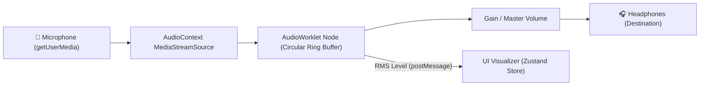

<div align="center">

# 🌐 Echo Loop

**A modern, cross-platform Delayed Auditory Feedback (DAF) application for Web and Android, built with React, Vite, Tailwind CSS, and Capacitor.**

[](https://github.com/ritikthakur22/Echo_Loop/actions/workflows/ci.yml)
[](https://echo-loop-rho.vercel.app/)
[](https://opensource.org/licenses/MIT)
[](https://reactjs.org/)
[](https://www.typescriptlang.org/)
[](https://vitejs.dev/)
[](https://capacitorjs.com/)
[](https://tailwindcss.com/)

[Live Demo](https://echo-loop-rho.vercel.app/) · [Download APK](https://github.com/ritikthakur22/Echo_Loop/releases) · [Report Bug](https://github.com/ritikthakur22/Echo_Loop/issues) · [Request Feature](https://github.com/ritikthakur22/Echo_Loop/issues)

</div>

---

## 📖 Overview

**Echo Loop** is a low-latency **Delayed Auditory Feedback (DAF)** tool designed for speech research, fluency practice, speech therapy, and auditory experimentation. By recording your voice through the microphone and feeding it back into your headphones after an adjustable delay (50ms – 3000ms), Echo Loop creates the classic DAF effect.

- **For Speech Therapy:** DAF has been shown clinically to help individuals who stutter speak more fluently by slowing speech rate and promoting prolonged phonation.
- **For Speech Jamming:** For fluent speakers, delays between 150ms and 250ms disrupt normal auditory self-monitoring, creating a playful "speech jammer" effect that causes involuntary pauses and slurred speech.
- **100% Client-Side Privacy:** No audio streams or telemetry are recorded, uploaded, or transmitted anywhere. All processing is strictly local within your browser or device audio ring buffer.

> ⚠️ **Important:** Always wear **headphones or earphones** when using Echo Loop! Using open speakers will cause an acoustic feedback screech/loop between your microphone and speaker.

---

## ✨ Features

- 📱 **Cross-Platform:** Single TypeScript/React codebase running smoothly on desktop browsers, mobile browsers, and Android via Capacitor.
- ⚡ **Real-Time AudioWorklet:** Low-latency circular ring buffer processor running on a dedicated audio rendering thread for glitch-free playback.
- 🎛️ **Customizable Delay & Gain:** Adjust delay times smoothly from 50ms to 3000ms with fine-grained millisecond resolution.
- 🎯 **Curated Presets:** Instant configuration presets for Conversation (70ms), Speech Practice (120ms), and Classroom / Speech Jamming (175ms).
- 📊 **Live Audio Level Meter:** Real-time visual feedback meter showing live microphone RMS input levels.
- 🌓 **Dark / Light Modes:** Fully responsive, accessible UI styled with Tailwind CSS with system/manual theme toggle.
- 🔒 **Zero Data Collection:** Fully secure, open-source, and offline-capable.

---

## 🏗️ Architecture & Audio Pipeline

Echo Loop utilizes the W3C **Web Audio API** with an inline `AudioWorkletProcessor` spawned from a Blob URL for maximum portability across standard browsers and Android WebViews.



### The Ring Buffer Mechanism
1. A continuous `Float32Array` buffer sized to `sampleRate * 3.2` seconds is pre-allocated.
2. In the `process()` audio thread loop, microphone samples are written to `writeIndex`.
3. The delayed sample is read from `(writeIndex - delaySamples + bufferLength) % bufferLength`.
4. RMS volume calculation (`Math.sqrt(sum / length)`) sends periodic level metrics to the UI thread for smooth VU-meter animations without impacting audio rendering latency.

---

## 📦 App Releases & Demo

- **🌐 Live Web App:** [https://echo-loop-rho.vercel.app/](https://echo-loop-rho.vercel.app/)
- **🤖 Android App:** Download the latest signed `.apk` file directly from the [GitHub Releases](https://github.com/ritikthakur22/Echo_Loop/releases) page.

---

## 🛠️ Getting Started

### Prerequisites

- **Node.js** (v20 or v22 recommended)
- **npm** (v9 or higher)
- **Android Studio** (Required only for local Android compilation and debugging)

### Local Setup

```bash
# 1. Clone the repository
git clone https://github.com/ritikthakur22/Echo_Loop.git

# 2. Navigate into the project directory
cd Echo_Loop

# 3. Install NPM dependencies
npm install

# 4. Start the development server
npm run dev

# 5. Open in browser (Note: Microphone access requires localhost or HTTPS)
open http://localhost:5173
```

### Android Development with Capacitor

```bash
# Build web assets and synchronize with Android native container
npm run android:sync

# Open Android Studio to build, test on emulator, or deploy to device
npx cap open android

# Or build the debug APK directly via command line
npm run android:debug
```

---

## 📜 Available Scripts

| Command | Description |
| :--- | :--- |
| `npm run dev` | Starts the Vite development server with HMR |
| `npm run build` | Type-checks with `tsc -b` and bundles for production |
| `npm run preview` | Previews the production build locally |
| `npm run lint` | Runs ESLint across all TypeScript and React files |
| `npm run test` | Runs the Vitest test suite once |
| `npm run test:watch` | Runs Vitest in interactive watch mode |
| `npm run android:sync` | Builds web assets and syncs with Capacitor Android |
| `npm run android:debug` | Builds web assets, syncs, and compiles Android Debug APK |

---

## 🧪 Testing & CI

Continuous Integration is set up via GitHub Actions (`.github/workflows/ci.yml`), testing on multiple Node.js environments (`node-20`, `node-22`) across every push and pull request to `main`.

Run unit tests locally:
```bash
npm run test
```

---

## 🤝 Contributing

Contributions, bug reports, and suggestions are welcome!

1. Fork the Project
2. Create your Feature Branch (`git checkout -b feature/AmazingFeature`)
3. Commit your Changes (`git commit -m 'feat: add AmazingFeature'`)
4. Push to the Branch (`git push origin feature/AmazingFeature`)
5. Open a Pull Request

---

## 📄 License

Distributed under the MIT License. See [LICENSE](LICENSE) for more information.

---

<div align="center">
Made with ❤️ by <a href="https://github.com/ritikthakur22">Ritik Thakur</a>
</div>
